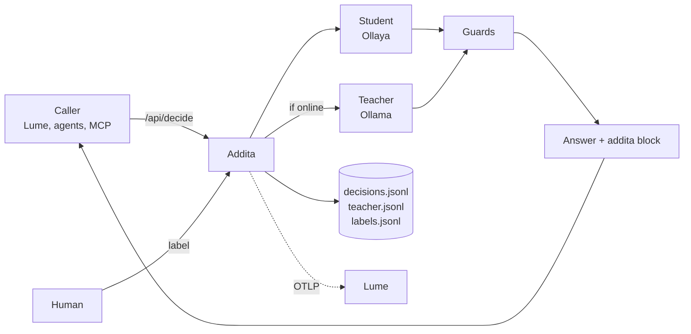

<div align="center">

# Addita

**Decisions that teach themselves.**

[](LICENSE)
[](package.json)
[](#mcp-tools)
[](#http-api)

[How it works](#how-it-works) · [Quick start](#quick-start) · [HTTP API](#http-api) · [MCP tools](#mcp-tools) · [Training loop](#the-training-loop) · [Configuration](#configuration)

</div>

---

Small decision models are fast, cheap and run anywhere, including a Raspberry Pi with no network. They are also only as good as the labels they were trained on. Large LLMs make good labels, but they are slow, sometimes offline, and sometimes in the cloud.

Addita puts the two together. It sits where [Ollaya](https://github.com/ollaya-dev/ollaya) sits and speaks Ollaya's API, so a caller can point at it with no change to the requests it sends. Every decision is answered by the small model (the **student**). When an [Ollama](https://ollama.com) model (the **teacher**) is reachable, it answers the same typed questions, and both answers are saved as a training pair. Deterministic **guards** override both for rules that must never depend on a model. Over time your own corrections show when the student is good enough to stand alone.

### Built for places where the network is optional

Addita was built for boats: a Pi on the nav station, a GPU box somewhere else on the LAN, and a satellite link that comes and goes. When the teacher is offline, the student still answers, guards still apply, and the decision is still stored. Only the teacher's half of the training row waits, and `training_backfill` fills it in when the teacher returns. Over HTTP, guards and logging keep running even when *both* models are down. (An MCP call made with `teacher: require` still fails before guards and logging while the teacher is offline; that fix is deferred.)

## Highlights

- **Ollaya-compatible.** Same endpoints, same request and response shapes, and the same error codes. Addita handles decisions itself and forwards everything else to Ollaya. Tested against a live Ollaya 0.7.2.
- **Cloud or local teacher.** A cloud teacher by default, with a local model answering whenever the cloud doesn't. `ADDITA_NO_CLOUD=1` keeps everything on the machine.
- **Student and teacher on every call.** The teacher answers blind by default, so it can't anchor on the student.
- **Guards win.** Regex rules force answers for safety-critical cases (MAYDAY → `distress`, `alert_operator`). Guards read the preset's text field (e.g. `transcript`), not context retrieved from Lume. Guard outputs are logged with the decision but never used as training labels.
- **Nothing acts on its own.** Addita labels and recommends. A person approves anything that matters.
- **Training data as you go.** Every successful call is a row. Label the disagreements, watch agreement climb, then calibrate or fine-tune.
- **Any decision, not one domain.** Questions are typed (`noul`, `choice`, `score`) and live in presets. Marine VHF comms and Lume SQL judging (`lume.sql_judge`) ship as examples.
- **Logs to [Lume](https://github.com/DeepBlueDynamics/lume).** Every decision becomes searchable, filterable analytics, over the Lume CLI and OTLP.
- **Local by default.** Data lives in plain JSONL under `~/.addita`.

## How it works



1. **The student answers.** Ollaya runs the typed questions locally. It is fast and always runs.
2. **The teacher answers, if it's up.** Ollama gets the same questions with a JSON schema, so it can only pick valid labels.
3. **Both are saved.** That pair is a training row.
4. **Guards override both.** Deterministic rules on the new input only.
5. **The answer goes back.** The teacher's answer while it is online, the student's while it is not, with guards applied either way.
6. **The decision is logged.** To local JSONL, and to Lume.

## Quick start

Requires Node 20+.

```sh
# Ollaya, the student (64-bit OS with glibc ≥ 2.38)
curl -fsSL https://ollaya.dev/install.sh | sh
ollaya pull laya

# Ollama, the teacher (here or anywhere on your network)
ollama pull qwen3.5:4b

# Addita
git clone https://github.com/DeepBlueDynamics/addita.git
cd addita
npm install          # also builds dist/
npm test             # end-to-end test against mock backends
```

### Hook it up to Claude Code

```sh
claude mcp add addita \
  -e OLLAMA_URL=http://gpu-box:11434 -e OLLAMA_MODEL=qwen3.5:4b \
  -- node /path/to/addita/dist/index.js
```

### Codex

```toml
# ~/.codex/config.toml
[mcp_servers.addita]
command = "node"
args = ["/path/to/addita/dist/index.js"]
env = { OLLAMA_URL = "http://gpu-box:11434", OLLAMA_MODEL = "qwen3.5:4b" }
```

### Docker

With Docker Compose, from the repo root, on a Linux box with an NVIDIA GPU:

```sh
docker compose up -d --build
curl -sN localhost:11435/api/pull -d '{"model":"laya"}'   # student models, first run only
ollama signin                                              # host Ollama, for the cloud teacher
```

`compose.yml` runs Ollaya in a GPU container and builds Addita with host networking, so Addita uses the Ollama already on the box (`127.0.0.1:11434`) as its teacher. If the box has no Ollama, uncomment the `ollama` service. The first `up` downloads about 1.7 GB of images before it returns.

Or run the Addita image on its own:

```sh
docker build -t addita .
docker run -d --name addita -p 11345:11345 -v addita-data:/data \
  -e OLLAYA_URL=http://<ollaya-host>:11435 -e OLLAMA_URL=http://<ollama-host>:11434 addita
```

The image runs HTTP and `/mcp` only (`ADDITA_STDIO=false`), as a non-root user, with data in `/data` and a health check on `/health`.

## HTTP API

```sh
OLLAYA_URL=http://localhost:11435 OLLAMA_URL=http://localhost:11434 node dist/index.js
curl localhost:11345/health   # {"service":"addita","version":"0.1.0","ready":true,"ollaya":true,"ollama":true}
```

Addita listens on `0.0.0.0:11345` (set `ADDITA_PORT` explicitly; if it's unset and the port is busy, Addita picks a free one) and serves the [Ollaya API](https://github.com/ollaya-dev/ollaya/blob/main/docs/api.md). It also serves MCP over stdio (turn that off with `ADDITA_STDIO=false`), and writes its address to `~/.addita/serve.json` so local callers can find it. `POST /api/decide`, `/v1/systemone` and `/v1/decisions` run the student/teacher/guard loop. Every other endpoint (`/api/tags`, `/api/show`, `/api/pull`, `/api/create`, …) is forwarded to Ollaya unchanged. MCP is served over streamable HTTP at `/mcp`.

A request is a plain Ollaya decide, plus an optional `addita` block:

```json
{
  "model": "laya",
  "state": { "question": "Which tanks are below 20%?", "sql": "SELECT …", "rows": [], "answer": "None." },
  "questions": {
    "rows_answer_question": { "type": "noul", "criteria": { "true": "The rows contain what the question asks", "false": "They don't" } },
    "answer_supported": { "type": "noul", "criteria": { "true": "Every claim in the answer is backed by the rows", "false": "Some claim isn't" } }
  },
  "addita": { "ref": "lume-run-7c1e…" }
}
```

The response is Ollaya's native decide response, with the student's typed answers passed through untouched, plus an `addita` block. This example is abbreviated: `model` is the model that actually answered, and the native envelope fields (`routing`, `state_truncated`, `done_reason`, `created_at` and the three `*_duration` fields) are left out. See the [Ollaya API](https://github.com/ollaya-dev/ollaya/blob/main/docs/api.md) for the full shape.

```json
{
  "model": "…",
  "answers": {
    "rows_answer_question": { "type": "noul", "noul": 0.91 },
    "answer_supported": { "type": "noul", "noul": 0.84 }
  },
  "usage": { "input_tokens": 212, "output_tokens": 0 },
  "addita": {
    "id": "3f2a9c1e-…",
    "ref": "lume-run-7c1e…",
    "group": "lume-run-7c1e…",
    "final": { "rows_answer_question": true, "answer_supported": true },
    "source": "teacher",
    "teacher": "answered",
    "guards": [],
    "agreement": { "rows_answer_question": true }
  }
}
```

- `answers` is always the student's real output. Addita never invents probabilities for teacher or guard answers.
- `final` is the effective decision, with the teacher and guards applied. Read this one. A caller that reads only `answers` gets the student's view, not Addita's decision: the shapes are compatible, but the decisions can differ.
- `teacher` is `answered`, `pending` (offline, waiting for backfill), `skipped` or `failed`. `teacher_model` and `teacher_host` name the teacher that actually answered, and `student_ms` / `teacher_ms` give the time for each.
- `ref` is echoed from the request, and carried on Addita's OTLP records.
- `group` (optional, `addita.group`) ties related decisions together so exports never split them between train and eval. It defaults to `ref`, then the decision id.
- `GET /api/addita/decision/{id}` returns a decision's current state. `POST /api/addita/label` with `{id, labels}` records a correction.
- Errors use Ollaya's shape and codes: `{"error": "…", "code": "INVALID_REQUEST"}`.

## MCP tools

| Tool | What it does |
|---|---|
| `comms_decide` | Runs the loop. Takes `state` (string or JSON), optional `context`, a `preset` or ad-hoc `questions`, and `teacher` (`auto` / `skip` / `require`). Returns `id`, `answers`, `source`, `guards`, both models' answers and per-question `agreement`. |
| `comms_label` | Correct a past decision by `id`. These are the only gold labels. |
| `comms_search` | Search the decision log in Lume, with filters on the frontmatter fields: scalar state fields and final answers (`priority:distress`, `teacher:pending`, `labelled:true`). |
| `lume_sync` | Rewrite every stored decision as a Lume doc and reindex. |
| `training_stats` | Counts, guard hits and per-question agreement: student vs teacher, and both vs your labels. |
| `training_disagreements` | Unlabelled rows where student and teacher disagree. Label these first. |
| `training_backfill` | The teacher is back: answer the rows it missed. |
| `training_export` | Writes `train.jsonl`, `eval.jsonl`, `calibration.jsonl` and `manifest.json` under `exports/<time>/`, split by group. |
| `training_calibrate` | Temperature-scales the student's probabilities against your labels; can bake the result into a new Ollaya model. |
| `ollama_chat` | Simplified proxy to Ollama `/api/chat` (selected inputs and outputs, not wire-identical). Not logged. |
| `backends_status`, `ollaya_pull`, `presets_show` | Housekeeping. |

The `comms_*` names are historical. Domain-neutral names are coming, and the old names will stay as aliases.

## Presets

A preset is a JSON file in `presets/` holding `questions` (TypeSafe format), an optional `model`, a `text_field` that guards read, and `guards` (regex → forced answers).

| Question type | Answer | Example |
|---|---|---|
| `noul` | Ollaya: probability that a statement is true. MCP tools: a boolean. | "Is this addressed to us?" |
| `choice` | Ollaya: one label of 2–255, with probabilities. MCP tools: the label. | priority: distress, urgency, safety, routine, chatter, noise |
| `score` | Ollaya: a fractional score over 2–10 levels. MCP tools: the rounded level. | transcript quality: unusable, partial, clear |

`presets/comms.json` classifies marine VHF traffic: who it's for, how urgent, what it is, and what to do. Copy it to make your own.

## Lume

Addita logs to [Lume](https://github.com/DeepBlueDynamics/lume) so every decision is searchable. Today that is the CLI integration below, with metrics from `training_stats`. Metrics queryable with SQL arrive with OTLP logging *(in progress)*. Lume can also call Addita *(in progress on both sides)*, for example to judge whether the SQL its agent wrote actually answered the question, and reuse the good ones as worked examples.

Addita sends OTLP logs (`addita.decision`, `addita.decision.final`, `addita.label`) and metrics (`addita.decide.ms`, `addita.decide.count`, `addita.teacher.ms`, `addita.agreement`) to `lume serve --otlp`. It finds Lume through `~/.lume/serve.json`. This is fire-and-forget: if Lume isn't there, decisions carry on. *(Tested against a mock collector; not yet against a live `lume serve`.)*

It also writes each decision as a Markdown file and indexes it with the `lume` CLI. For dense vectors, index with Shivvr:

```sh
# set in the MCP server's env, or export before starting the MCP host
export LUME_INDEX_ARGS="--embed-model embeddinggemma-2 --embed-dimensions 256"
```

This assumes a running Shivvr (default `http://localhost:8085`).

## The training loop

1. **Run with the teacher on.** Use the stack normally; every successful call becomes a row.
2. **Label the disagreements.** `training_disagreements` → `comms_label`. A few minutes a day covers it.
3. **Watch `training_stats`.** When `student_accuracy_vs_human` matches `teacher_accuracy_vs_human` on a question, the student can own that question.
4. **Calibrate.** `training_calibrate` fits a temperature per bucket from human labels (about 30 per bucket). Add `create_model` to bake it into a new Ollaya model.
5. **Fine-tune if calibration isn't enough.** `training_export` writes:
   - `eval.jsonl`: only the questions a human labelled, nothing else. Score on this.
   - `train.jsonl`: labels in order human, then guard, then teacher; the student never labels itself. Each question's `label_source` says which. A guard-forced answer is marked `"guard"`, with `guard_overrides` naming the guard and `teacher_labels` keeping the teacher's original answer.
   - `calibration.jsonl` (when `calibration_fraction` > 0): same shape as train.
   - `manifest.json`: schema version, fractions, split rule and counts.

   Rows are split by `sha256(group)`. `group` is `addita.group` from the request, else `ref`, else the decision id. A group never lands in two files, and rows without a human label in an eval group are held out rather than trained. Fine-tune upstream, package into Ollaya, and score only on `eval.jsonl`.

### Things to know

- **The teacher is not the truth.** Distillation caps the student at roughly the teacher's quality, mistakes included. Only your labels measure real accuracy.
- **Guards are forced answers, not labels.** Their outputs are logged but never used as training labels. Keep safety-critical rules in guards rather than trusting either model with them.
- **Guards read one field.** They read the preset's `text_field`. If that field is missing or isn't a string, they currently scan the whole input JSON, including any context you passed in. Tightening this is in progress.
- **Context is part of the training row.** The state the models saw is what's stored, so a fine-tuned model learns to use context the way it gets it at run time.
- **Cloud teachers see your data.** The default teacher is a cloud model, so transcripts and query results leave the machine. Set `ADDITA_NO_CLOUD=1` to keep everything local, backfill included.

## Configuration

| Variable | Default | |
|---|---|---|
| `OLLAYA_URL` | `http://127.0.0.1:11435` | |
| `OLLAYA_API_KEY` | unset | Sent as a Bearer token if set |
| `OLLAYA_MODEL` | `laya` | Used when the preset names no model |
| `OLLAYA_TIMEOUT_MS` | `30000` | |
| `OLLAMA_URL` | `http://127.0.0.1:11434` | |
| `OLLAMA_MODEL` | `deepseek-v4.1-flash:cloud` | Teacher; any model that handles JSON-schema `format` well |
| `OLLAMA_LOCAL_MODEL` | `qwen3.5:4b` | Local teacher, used when the cloud fails or `ADDITA_NO_CLOUD=1` |
| `ADDITA_NO_CLOUD` | `0` | `1`: never send anything to a cloud teacher, including backfill |
| `OLLAMA_THINK` | unset | `0`/`1`: sets `think` on teacher calls. Unset sends `think: false`, which keeps teachers fast and their JSON valid |
| `OLLAMA_TIMEOUT_MS` | `120000` | |
| `OLLAMA_PROBE_TTL_MS` | `10000` | How long an online/offline check is cached |
| `ADDITA_TEACHER` | `auto` | `auto`, `off` or `always` |
| `ADDITA_TEACHER_SEES_STUDENT` | `0` | `1` lets the teacher correct the student instead of answering blind |
| `ADDITA_HOST` | `0.0.0.0` | HTTP bind address |
| `ADDITA_PORT` | `11345` | HTTP port; set it explicitly to stop Addita from falling back to a free port |
| `ADDITA_STDIO` | `true` | Also serve MCP on stdin/stdout, and exit when stdin closes. The Docker image sets it to `false` (HTTP and `/mcp` only). |
| `ADDITA_TOKEN_FILE` | unset | If set, requests need `Authorization: Bearer <token from this file>` |
| `ADDITA_SERVE_JSON` | `$ADDITA_DATA_DIR/serve.json` | Discovery file (`~/.addita/serve.json` by default) |
| `ADDITA_DATA_DIR` | `~/.addita` | `decisions.jsonl`, `teacher.jsonl`, `labels.jsonl`, `exports/` |
| `ADDITA_PRESETS_DIR` | `<package>/presets` | |
| `ADDITA_PRESET` | `comms` | |
| `ADDITA_LUME` | `auto` | `auto` uses Lume if the binary runs; `off` disables it |
| `LUME_BIN` | `lume` | |
| `LUME_DOCS_DIR` | `$ADDITA_DATA_DIR/lume-docs` | |
| `LUME_DB` | `$ADDITA_DATA_DIR/lume-db` | |
| `LUME_TAG_DICT` | `<package>/presets/callsigns.csv` | Entity dictionary for Lume's graph |
| `LUME_TIMEOUT_MS` | `60000` | |
| `LUME_SERVE_JSON` | `~/.lume/serve.json` | Where to find `lume serve` for OTLP |
| `LUME_INDEX_ARGS` | unset | Extra `lume index` flags, e.g. the Shivvr flags above |
| `LUME_REINDEX_DEBOUNCE_MS` | `3000` | |
| `LUME_CONTEXT_HITS` | `3` | Past decisions added as context; `0` turns it off |
| `LUME_CONTEXT_HOURS` | `24` | |

## Status

| | |
|---|---|
| Student/teacher loop, guards, training store, calibration | ✅ smoke tests pass (Node 24, tsc 7.0.2) |
| Ollaya-compatible HTTP API on :11345, with upstream error codes | ✅ live-tested against Ollaya 0.7.2: student answers identical to direct Ollaya, about 1 s per decide with the cloud teacher |
| Cloud teacher with local fallback and cloud backfill; `ADDITA_NO_CLOUD` | ✅ |
| MCP over stdio and streamable HTTP (`/mcp`) | ✅ tested with the official MCP SDK client |
| `lume.sql_judge` preset | ✅ |
| Lume log via CLI | ✅ covered by the smoke test when `lume` is installed (lume 0.15.3); skipped otherwise |
| OTLP logging to `lume serve` | ✅ against a mock collector · ⏳ not yet against a live `lume serve` |
| Guards and logging on HTTP when both models are down | ✅ |
| Guards and logging on MCP when `teacher: require` fails | 🚧 deferred |
| Training export: human-only `eval.jsonl`, guard-marked labels, grouped train/eval/calibration split, `manifest.json` | ✅ smoke tests pass |
| Fine-tuning pipeline (Laya, Cloud Run) | 🔬 research |

## Development

```sh
npm install
npm run build        # tsc
npm test             # build + test/smoke.mjs against mock Ollaya/Ollama
```

| Path | |
|---|---|
| `src/index.ts` | Entry point and MCP tool definitions |
| `src/server.ts` | HTTP server: Ollaya API, passthrough, `/mcp` |
| `src/mcp.ts` | MCP JSON-RPC server (stdio and HTTP) |
| `src/validate.ts` | Request validation and Ollaya error codes |
| `src/otlp.ts` | OTLP logs and metrics to Lume |
| `src/addita.ts` | The decide loop: student, teacher, guards, storage |
| `src/ollaya.ts`, `src/ollama.ts` | Backend clients |
| `src/questions.ts` | Question types, schemas and answer handling |
| `src/store.ts` | JSONL storage |
| `src/training.ts` | Stats, export and calibration |
| `src/lume.ts` | Lume log and context |
| `presets/` | Question sets and guards |
| `test/` | Smoke test and mock backends |

## License

[BSD 3-Clause](LICENSE). Copyright © 2026 DeepBlue Dynamics LLC and Kord Campbell.
