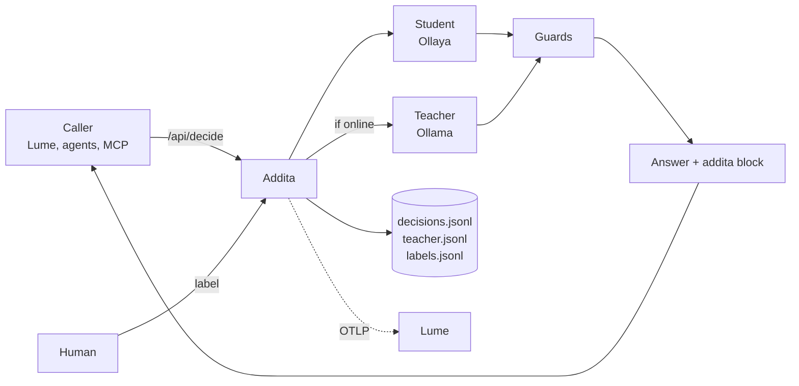

<div align="center">

# Addita

**Decisions that teach themselves.**

[](LICENSE)
[](package.json)
[](#mcp-tools)
[](#http-api)

[How it works](#how-it-works) · [Quick start](#quick-start) · [HTTP API](#http-api) · [MCP tools](#mcp-tools) · [Training loop](#the-training-loop) · [Configuration](#configuration)

</div>

---

Small decision models are fast, cheap and run anywhere, including a Raspberry Pi with no network. They are also only as good as the labels they were trained on. Large LLMs make good labels, but they are slow, sometimes offline, and sometimes in the cloud.

Addita puts the two together. It sits where [Ollaya](https://github.com/ollaya-dev/ollaya) sits and speaks Ollaya's API, so any caller can point at it unchanged. Every decision is answered by the small model (the **student**). When an [Ollama](https://ollama.com) model (the **teacher**) is reachable, it answers the same typed questions, and both answers are saved as a training pair. Deterministic **guards** override both for rules that must never depend on a model. Over time your own corrections show when the student is good enough to stand alone.

### Built for places where the network is optional

Addita was built for boats: a Pi on the nav station, a GPU box somewhere else on the LAN, and a satellite link that comes and goes. Everything keeps working when the teacher is offline. Decisions, guards and logging all run, and only training waits. When the teacher comes back, `training_backfill` catches up.

## Highlights

- **Ollaya-compatible.** Same endpoints, same request and response shapes. Addita handles decisions itself and forwards everything else to Ollaya. *(HTTP API in progress; see [Status](#status).)*
- **Student and teacher on every call.** The teacher answers blind by default, so it can't anchor on the student.
- **Guards win.** Regex rules force answers for safety-critical cases (MAYDAY → `distress`, `alert_operator`). Guards read only the new input, never retrieved context, and their output is never written as training data.
- **Nothing acts on its own.** Addita labels and recommends. A person approves anything that matters.
- **Training data as you go.** Every call is a row. Label the disagreements, watch agreement climb, then calibrate or fine-tune.
- **Any decision, not one domain.** Questions are typed (`noul`, `choice`, `score`) and live in presets. Marine VHF comms and Lume SQL judging ship as examples.
- **Logs to [Lume](https://github.com/DeepBlueDynamics/lume).** Every decision becomes searchable, filterable analytics. *(OTLP logging in progress.)*
- **Local by default.** Data lives in plain JSONL under `~/.addita`.

## How it works



1. **The student answers.** Ollaya runs the typed questions locally. It is fast and always runs.
2. **The teacher answers, if it's up.** Ollama gets the same questions with a JSON schema, so it can only pick valid labels.
3. **Both are saved.** That pair is a training row.
4. **Guards override both.** Deterministic rules on the new input only.
5. **The answer goes back.** The teacher's answer while it is online, the student's while it is not, with guards applied either way.
6. **Everything is logged.** To local JSONL, and to Lume.

## Quick start

Requires Node 20+.

```sh
# Ollaya, the student (64-bit OS with glibc ≥ 2.38)
curl -fsSL https://ollaya.dev/install.sh | sh
ollaya pull laya

# Ollama, the teacher (here or anywhere on your network)
ollama pull qwen3.5:4b

# Addita
git clone https://github.com/DeepBlueDynamics/addita.git
cd addita
npm install          # also builds dist/
npm test             # end-to-end test against mock backends
```

### Hook it up to Claude Code

```sh
claude mcp add addita \
  -e OLLAMA_URL=http://gpu-box:11434 -e OLLAMA_MODEL=qwen3.5:4b \
  -- node /path/to/addita/dist/index.js
```

### Codex

```toml
# ~/.codex/config.toml
[mcp_servers.addita]
command = "node"
args = ["/path/to/addita/dist/index.js"]
env = { OLLAMA_URL = "http://gpu-box:11434", OLLAMA_MODEL = "qwen3.5:4b" }
```

## HTTP API

> **In progress.** This section describes the target. Today Addita runs as an MCP server over stdio.

Addita listens on port **11345** and serves the [Ollaya API](https://github.com/ollaya-dev/ollaya/blob/main/docs/api.md). `POST /api/decide`, `/v1/systemone` and `/v1/decisions` run the student/teacher/guard loop. Every other endpoint (`/api/tags`, `/api/show`, `/api/pull`, `/api/create`, …) is forwarded to Ollaya unchanged. MCP is served over streamable HTTP at `/mcp`.

A request is a plain Ollaya decide:

```json
{
  "model": "laya",
  "state": { "question": "Which tanks are below 20%?", "sql": "SELECT …", "rows": [], "answer": "None." },
  "preset": "lume.sql_judge",
  "addita": { "ref": "lume-run-7c1e…" }
}
```

The response is Ollaya's, with the student's typed answers passed through untouched, plus an `addita` block that callers can read or ignore:

```json
{
  "model": "laya",
  "answers": { "rows_answer_question": { "type": "noul", "noul": 0.91 } },
  "usage": { "input_tokens": 212, "output_tokens": 0 },
  "addita": {
    "id": "3f2a9c1e-…",
    "ref": "lume-run-7c1e…",
    "final": { "rows_answer_question": true, "answer_supported": true },
    "source": "teacher",
    "teacher": "answered",
    "guards": [],
    "agreement": { "rows_answer_question": true }
  }
}
```

- `answers` is always the student's real output. Addita never invents probabilities for teacher or guard answers.
- `final` is the effective decision. Read this one.
- `teacher` is `answered`, `pending` (offline, waiting for backfill), `skipped` or `failed`.

## MCP tools

| Tool | What it does |
|---|---|
| `comms_decide` | Runs the loop. Takes `state` (string or JSON), optional `context`, a `preset` or ad-hoc `questions`, and `teacher` (`auto` / `skip` / `require`). Returns `id`, `answers`, `source`, `guards`, both models' answers and per-question `agreement`. |
| `comms_label` | Correct a past decision by `id`. These are the only gold labels. |
| `comms_search` | Search the decision log in Lume, with filters on any logged field (`priority:distress`, `teacher:pending`, `labelled:true`). |
| `lume_sync` | Rewrite every stored decision as a Lume doc and reindex. |
| `training_stats` | Counts, guard hits and per-question agreement: student vs teacher, and both vs your labels. |
| `training_disagreements` | Unlabelled rows where student and teacher disagree. Label these first. |
| `training_backfill` | The teacher is back: answer the rows it missed. |
| `training_export` | Writes `train.jsonl` and `eval.jsonl` under `exports/<time>/`. |
| `training_calibrate` | Temperature-scales the student's probabilities against your labels; can bake the result into a new Ollaya model. |
| `ollama_chat` | Plain pass-through to Ollama `/api/chat`. Not logged. |
| `backends_status`, `ollaya_pull`, `presets_show` | Housekeeping. |

The `comms_*` names are historical. Domain-neutral names are coming, and the old names will stay as aliases.

## Presets

A preset is a JSON file in `presets/` holding `questions` (TypeSafe format), an optional `model`, a `text_field` that guards read, and `guards` (regex → forced answers).

| Question type | Answer | Example |
|---|---|---|
| `noul` | probability that a statement is true | "Is this addressed to us?" |
| `choice` | one label of 2–255 | priority: distress, urgency, safety, routine, chatter, noise |
| `score` | a level of 2–10 | transcript quality: unusable, partial, clear |

`presets/comms.json` classifies marine VHF traffic: who it's for, how urgent, what it is, and what to do. Copy it to make your own.

## Lume

Addita logs to [Lume](https://github.com/DeepBlueDynamics/lume) so every decision is searchable and every metric is queryable with SQL. Lume can also call Addita, for example to judge whether the SQL its agent wrote actually answered the question, and reuse the good ones as worked examples.

Today Addita writes each decision as a Markdown file and indexes it with the `lume` CLI. For dense vectors, index with Shivvr:

```sh
LUME_INDEX_ARGS="--embed-model embeddinggemma-2 --embed-dimensions 256"
```

*In progress:* OTLP/HTTP logging to `lume serve --otlp` (`/v1/logs`, `/v1/metrics`), discovered through `~/.lume/serve.json`.

## The training loop

1. **Run with the teacher on.** Use the stack normally; every call becomes a row.
2. **Label the disagreements.** `training_disagreements` → `comms_label`. A few minutes a day covers it.
3. **Watch `training_stats`.** When `student_accuracy_vs_human` matches `teacher_accuracy_vs_human` on a question, the student can own that question.
4. **Calibrate.** `training_calibrate` fits a temperature per bucket from human labels (about 30 per bucket). Add `create_model` to bake it into a new Ollaya model.
5. **Fine-tune if calibration isn't enough.** `training_export` gives `train.jsonl` (human labels first, teacher labels second; the student never labels itself) and `eval.jsonl` (human labels only). Fine-tune upstream, package into Ollaya, and score only on `eval.jsonl`.

### Things to know

- **The teacher is not the truth.** Distillation caps the student at roughly the teacher's quality, mistakes included. Only your labels measure real accuracy.
- **Guards are forced answers, not labels.** Keep safety-critical rules in guards rather than trusting either model with them.
- **Context is part of the training row.** The state the models saw is what's stored, so a fine-tuned model learns to use context the way it gets it at run time.
- **Cloud teachers see your data.** If `OLLAMA_MODEL` is a cloud model, transcripts and query results leave the machine. Use a local teacher for private data.

## Configuration

| Variable | Default | |
|---|---|---|
| `OLLAYA_URL` | `http://127.0.0.1:11435` | |
| `OLLAYA_API_KEY` | unset | Sent as a Bearer token if set |
| `OLLAYA_MODEL` | `laya` | Used when the preset names no model |
| `OLLAMA_URL` | `http://127.0.0.1:11434` | |
| `OLLAMA_MODEL` | `qwen3:8b` | Teacher; any model that handles JSON-schema `format` well |
| `OLLAMA_THINK` | unset | `0`/`1`: passes `think` to Ollama |
| `OLLAMA_TIMEOUT_MS` | `120000` | |
| `OLLAMA_PROBE_TTL_MS` | `10000` | How long an online/offline check is cached |
| `ADDITA_TEACHER` | `auto` | `auto`, `off` or `always` |
| `ADDITA_TEACHER_SEES_STUDENT` | `0` | `1` lets the teacher correct the student instead of answering blind |
| `ADDITA_DATA_DIR` | `~/.addita` | `decisions.jsonl`, `teacher.jsonl`, `labels.jsonl`, `exports/` |
| `ADDITA_PRESETS_DIR` | `./presets` | |
| `ADDITA_PRESET` | `comms` | |
| `ADDITA_LUME` | `auto` | `auto` uses Lume if the binary runs; `off` disables it |
| `LUME_BIN` | `lume` | |
| `LUME_DOCS_DIR` | `$ADDITA_DATA_DIR/lume-docs` | |
| `LUME_DB` | `$ADDITA_DATA_DIR/lume-db` | |
| `LUME_TAG_DICT` | `presets/callsigns.csv` | Entity dictionary for Lume's graph |
| `LUME_INDEX_ARGS` | unset | Extra `lume index` flags, e.g. the Shivvr flags above |
| `LUME_REINDEX_DEBOUNCE_MS` | `3000` | |
| `LUME_CONTEXT_HITS` | `3` | Past decisions added as context; `0` turns it off |
| `LUME_CONTEXT_HOURS` | `24` | |

## Status

| | |
|---|---|
| Student/teacher loop, guards, training store, calibration | ✅ works; smoke tests pass against mock backends |
| MCP server (stdio) | ✅ |
| Lume log via CLI | ✅ |
| Ollaya-compatible HTTP API on :11345 | 🚧 in progress |
| MCP over streamable HTTP (`/mcp`) | 🚧 in progress |
| OTLP logging to `lume serve` | 🚧 in progress |
| Guards and logging when both models are down | 🚧 in progress |
| Tested against live Ollaya | ⏳ not yet; mocks only |

## Development

```sh
npm install
npm run build        # tsc
npm test             # build + test/smoke.mjs against mock Ollaya/Ollama
```

| Path | |
|---|---|
| `src/index.ts` | MCP server and tool definitions |
| `src/addita.ts` | The decide loop: student, teacher, guards, storage |
| `src/ollaya.ts`, `src/ollama.ts` | Backend clients |
| `src/questions.ts` | Question types, schemas and answer handling |
| `src/store.ts` | JSONL storage |
| `src/training.ts` | Stats, export and calibration |
| `src/lume.ts` | Lume log and context |
| `presets/` | Question sets and guards |
| `test/` | Smoke test and mock backends |

## License

[BSD 3-Clause](LICENSE). Copyright © 2026 DeepBlue Dynamics LLC and Kord Campbell.
